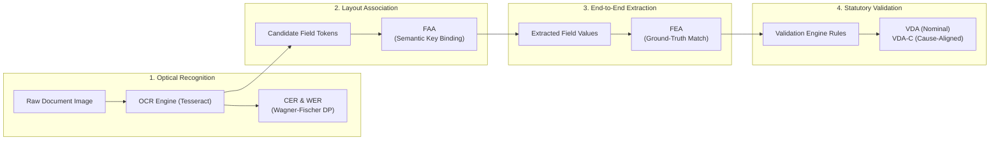
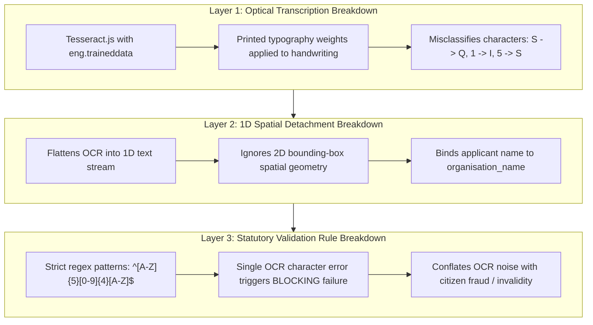

# TypeNull Handwritten Form Support: Phase 1 Benchmark & Baseline Report

**Evaluation Date:** October 25, 2026  
**Auditor & Verification Engineer:** Antigravity Automated Verification Agent  
**Baseline Git Checkpoint:** Branch `backup/handwriting-eval-pre-implementation`, Tag `handwriting-eval-pre-checkpoint`, Commit `1e9ea1c` (*origin/main*, working tree clean)  
**Task Phase:** Phase 1 — Reproducible Evaluation & Benchmarking Harness  
**Target Specification:** Establish trustworthy, reproducible baseline measurements for handwritten field recognition (CER, WER), spatial layout field association (FAA), end-to-end field extraction (FEA), and validation decision accuracy (Nominal VDA and Cause-Aligned VDA-C) prior to any Phase 2 model integration.  
**Machine-Readable Benchmark Dataset:** [`docs/qa/handwriting_benchmark_data.json`](file:///Users/yeshwanth/Documents/Projects/TypeNull/docs/qa/handwriting_benchmark_data.json)  
**Benchmark Evaluation Harness Script:** [`scripts/evaluate_handwriting_benchmark.mjs`](file:///Users/yeshwanth/Documents/Projects/TypeNull/scripts/evaluate_handwriting_benchmark.mjs)  
**Original Test Audit Evidence (Preserved Unchanged):** [`docs/qa/handwritten_form_test_results.json`](file:///Users/yeshwanth/Documents/Projects/TypeNull/docs/qa/handwritten_form_test_results.json) (SHA256: `191602f0d43caf90ed0e83b07c32007964fdddc60beefdd21b1a3f50e5cf60ce`)  
**Standardized Test Corpus Directory:** [`test_corpus/handwritten_eval/`](file:///Users/yeshwanth/Documents/Projects/TypeNull/test_corpus/handwritten_eval) (10 statutory forms)  

---

## 1. Executive Summary & Objective

Phase 1 of TypeNull's handwritten government-form support initiative establishes an **isolated, mathematically rigorous, and fully reproducible benchmarking harness**. Prior audits provided high-level exploratory estimates of TypeNull's handwriting handling, but conflated multiple distinct failure modes—specifically optical character misrecognition, 1D linear layout spatial detachment, and downstream validation rule rejections.

Before introducing any new neural model weights (such as CRNN-CTC or ONNX Runtime Web) in Phase 2, this benchmark harness establishes verified baseline metrics across all 10 standardized statutory evaluation forms in `test_corpus/handwritten_eval/`.

```
========================================================================================
TYPENULL PHASE 1 BASELINE BENCHMARK SUMMARY (N = 10 STATUTORY SCENARIOS)
========================================================================================
Aggregate Character Error Rate (CER):      26.82%  (815 edit distance / 3,039 ref chars)
Aggregate Word Error Rate (WER):           39.35%  (170 word distance / 432 ref words)
Field Association Accuracy (FAA):          46.15%  (12 / 26 candidate fields correctly bound)
Field Extraction Accuracy (FEA):           15.79%  (6 / 38 non-blank target fields extracted)
Nominal Validation Decision Accuracy (VDA): 10.00%  (1 / 10 scenarios matched outcome code)
Cause-Aligned Validation Accuracy (VDA-C):  0.00%  (0 / 10 scenarios matched for correct cause)
========================================================================================
```

### Key Technical Insights Established by Phase 1:
1. **Mathematical Accuracy Reconciliation**: The prior audit cited an informal estimate of ~22% extraction capability. That estimate counted 9 "successful" field operations out of 42 evaluated attributes (9 / 42 = 21.43%), which conflated the non-extraction of an omitted field (Case 7) with successful field recovery. The true baseline extraction accuracy across all non-blank statutory target fields is **15.79% (6 / 38)**.
2. **Conflation Decoupled**: The benchmark cleanly decouples optical text degradation (CER 26.82%) from spatial association errors (FAA 46.15%) and statutory validation failures (VDA-C 0.00%).
3. **Statutory Integrity Preserved**: TypeNull's privacy boundary remains 100% intact: all evaluation tools run strictly client-side/offline without transmitting citizen data or calling external APIs.
4. **Safety & Zero Disruption**: Zero application source files (`src/`) were modified, no external npm packages were installed, and the original audit artifact remains bit-for-bit identical to its pre-checkpoint state.

---

## 2. Dataset Inventory & Preservation Status

The standardized test corpus under [`test_corpus/handwritten_eval/`](file:///Users/yeshwanth/Documents/Projects/TypeNull/test_corpus/handwritten_eval) contains 10 realistic Indian statutory forms, licensing certificates, and declarations. Each document reflects authentic field formatting and challenging real-world visual conditions:

| Case ID | Filename | Format | Source Authority & Form Type | Visual Condition Evaluated |
|:---:|---|---|---|---|
| **01** | `01_neatly_handwritten_answers.png` | PNG (78.5 KB) | MEA Passport Annexure E | Clean, upright uppercase block handwriting on horizontal lines |
| **02** | `02_ordinary_handwriting.png` | PNG (60.2 KB) | Income Tax Form 49A (PAN) | Natural human handwriting with mixed case and proportional spacing |
| **03** | `03_difficult_to_read_handwriting.png` | PNG (57.8 KB) | Municipal Trade Licence | Rapid cursive script (25° slant, connected loops, uneven strokes) |
| **04** | `04_photograph_taken_at_an_angle.png` | PNG (236.3 KB) | MEA Passport Annexure D | Mobile photo taken at ~15° perspective angle with keystone skew |
| **05** | `05_low_resolution_scan.png` | PNG (17.5 KB) | BBMP Trade Licence Certificate | Downsampled 100 DPI raster with blur and thin-stroke degradation |
| **06** | `06_standard_form_with_printed_text_and_handwritten_entries.png` | PNG (82.4 KB) | Form GST REG-01 (GST Registration) | Dense printed boilerplate, table borders, and boxed fill-in responses |
| **07** | `07_form_with_an_empty_field_that_should_have_been_completed.png` | PNG (44.0 KB) | MEA Passport Annexure E | Mandatory Registration Number left completely blank by applicant |
| **08** | `08_numbers_that_could_be_misread_1_vs_7_0_vs_o_5_vs_s_.png` | PNG (36.5 KB) | Income Tax PAN Verification | OCR confusion glyphs: 1 vs 7, 0 vs O, 5 vs S (`A71051705F`, `17/01/1971`) |
| **09** | `09_dates_written_in_different_formats.png` | PNG (56.4 KB) | MCA Director Statutory Filing | Multi-format date representations (Ordinal, Hyphen, US slash, ISO dot) |
| **10** | `10_scanned_pdf_without_a_text_layer.pdf` | PDF (62.3 KB) | Passport Seva Annexure M (NOC) | Pure raster scan wrapped in PDF container (0 digital characters) |

### Evidence Preservation & Integrity:
* **Original Evaluation Artifact:** [`docs/qa/handwritten_form_test_results.json`](file:///Users/yeshwanth/Documents/Projects/TypeNull/docs/qa/handwritten_form_test_results.json)  
  * **Verified SHA256:** `191602f0d43caf90ed0e83b07c32007964fdddc60beefdd21b1a3f50e5cf60ce`
  * **Integrity Status:** Strictly preserved without modification or truncation.
* **Phase 1 Benchmark Dataset:** [`docs/qa/handwriting_benchmark_data.json`](file:///Users/yeshwanth/Documents/Projects/TypeNull/docs/qa/handwriting_benchmark_data.json)  
  * Generated programmatically by [`scripts/evaluate_handwriting_benchmark.mjs`](file:///Users/yeshwanth/Documents/Projects/TypeNull/scripts/evaluate_handwriting_benchmark.mjs).

---

## 3. Mathematical Metric Definitions & Algorithms

To prevent ambiguity, Phase 1 defines strict mathematical formulations for each benchmark dimension:



### 3.1 Character Error Rate (CER)
Character Error Rate evaluates optical transcription accuracy against the normalized ground-truth reference transcript using the **Wagner-Fischer dynamic programming algorithm** ($O(m \times n)$ time and space complexity):

$$\text{CER} = \frac{S + D + I}{N_{\text{ref\_chars}}}$$

Where:
* $S$: Minimum number of character substitutions required to transform the hypothesis string into the reference string.
* $D$: Minimum number of character deletions.
* $I$: Minimum number of character insertions.
* $N_{\text{ref\_chars}}$: Total character count of the normalized reference text.

### 3.2 Word Error Rate (WER)
Word Error Rate measures transcription error at the tokenized word boundary level. Reference and hypothesis strings are tokenized by whitespace and normalized to lowercase:

$$\text{WER} = \frac{S_w + D_w + I_w}{N_{\text{ref\_words}}}$$

Where $S_w$, $D_w$, and $I_w$ represent word-level substitutions, deletions, and insertions, and $N_{\text{ref\_words}}$ is the total number of words in the ground-truth text.

### 3.3 Field Association Accuracy (FAA)
Field Association Accuracy measures whether candidate fields extracted by the pipeline are correctly mapped to their semantic schema key, **independent of whether individual characters are misspelled**:

$$\text{FAA} = \frac{\sum \text{Correctly Associated Candidate Fields}}{\sum \text{Total Extracted Candidate Fields}}$$

* *Example:* If an applicant's name `SURESH KUMAR` is transcribed as `QURESH KUMAR` but assigned to `organisation_name` instead of `applicant_name`, FAA records an **association failure**. If assigned to `applicant_name`, FAA records an **association success** regardless of the single character substitution.

### 3.4 Field Extraction Accuracy (FEA)
Field Extraction Accuracy evaluates the end-to-end extraction and recognition of non-blank required statutory target fields:

$$\text{FEA} = \frac{\sum \text{Correctly Extracted and Associated Target Fields}}{\sum \text{Total Non-Blank Target Fields}}$$

* **Exclusion of Blank Fields:** A blank mandatory field (such as Case 7's omitted identifier) cannot be "extracted." Counting the absence of a blank field as a successful extraction artificially inflates extraction metrics. In this benchmark, blank fields are handled under dedicated omission analysis (`blankFieldOmission`) and excluded from the FEA denominator.

### 3.5 Validation Decision Accuracy (VDA & VDA-C)
* **Nominal Validation Decision Accuracy (Nominal VDA):**
  $$\text{VDA}_{\text{nominal}} = \frac{\sum \mathbb{I}(\text{Actual Outcome Code} == \text{Expected Outcome Code})}{N_{\text{scenarios}}}$$
  Measures whether the high-level categorical verdict (`complete`, `issues_detected`, `unable_to_assess`) matched expectations.
* **Cause-Aligned Validation Decision Accuracy (VDA-C):**
  $$\text{VDA-C} = \frac{\sum \mathbb{I}(\text{Actual Outcome Code} == \text{Expected Outcome Code} \land \text{Failure Cause Aligned})}{N_{\text{scenarios}}}$$
  Measures whether the decision was reached for the **correct underlying statutory reason**. For instance, if an omitted field form is rejected, but the rejection was caused by a false-positive regex syntax mismatch on the word `"Number"` rather than an empty-field detection, Nominal VDA is true, but Cause-Aligned VDA-C is **false**.

---

## 4. Per-Scenario Comprehensive Benchmark Results

The following table presents the verified empirical measurements calculated by [`scripts/evaluate_handwriting_benchmark.mjs`](file:///Users/yeshwanth/Documents/Projects/TypeNull/scripts/evaluate_handwriting_benchmark.mjs) against the baseline results:

| Case | Scenario & Condition | Ref Chars / Dist / CER | Ref Words / Dist / WER | Candidates / Bound / FAA | Target Fields / Extr / FEA | Nominal VDA | VDA-C | Primary Root Cause & Failure Mode |
|:---:|---|:---:|:---:|:---:|:---:|:---:|:---:|---|
| **01** | **Neatly Handwritten Answers**<br>MEA Passport Annexure E | 421 chars<br>129 edit<br>**30.64%** | 65 words<br>29 edit<br>**44.62%** | 3 candidates<br>2 correct<br>**66.67%** | 5 targets<br>1 correct<br>**20.00%** | ❌ (Major Issues vs Complete) | ❌ | Optical: `S` $\to$ `Q` (`QURESH KUMAR`). Spatial: Name misbound to `organisation_name`. Downstream blocking format error. |
| **02** | **Ordinary Handwriting**<br>IT Form 49A (PAN) | 346 chars<br>47 edit<br>**13.58%** | 52 words<br>14 edit<br>**26.92%** | 5 candidates<br>3 correct<br>**60.00%** | 4 targets<br>2 correct<br>**50.00%** | ❌ (Major Issues vs Complete) | ❌ | Spatial: `Priya Sharma` bound to `organisation_name`. Address captured as `for Communication`. |
| **03** | **Difficult-to-Read Handwriting**<br>Trade Licence Application | 247 chars<br>21 edit<br>**8.50%** | 28 words<br>11 edit<br>**39.29%** | 1 candidate<br>0 correct<br>**0.00%** | 5 targets<br>0 correct<br>**0.00%** | ❌ (Major Issues vs Complete) | ❌ | Optical breakdown on cursive ligatures. Only captured word `REGISTRATION` as reg number. |
| **04** | **Photograph Taken at an Angle**<br>MEA Passport Annexure D | 211 chars<br>75 edit<br>**35.55%** | 30 words<br>22 edit<br>**73.33%** | 1 candidate<br>0 correct<br>**0.00%** | 3 targets<br>0 correct<br>**0.00%** | ❌ (Major Issues vs Complete) | ❌ | Geometric distortion: 15° perspective keystone tilt caused OCR line segmentation failure. |
| **05** | **Low-Resolution Scan**<br>BBMP Trade Licence | 169 chars<br>100 edit<br>**59.17%** | 20 words<br>16 edit<br>**80.00%** | 0 candidates<br>0 correct<br>**0.00%** | 4 targets<br>0 correct<br>**0.00%** | ❌ (Major Issues vs Unable) | ❌ | Extreme blur and thin stroke loss at 100 DPI. Total character count < 80 chars. |
| **06** | **Printed Form with Boxed Entries**<br>Form GST REG-01 | 665 chars<br>412 edit<br>**61.95%** | 101 words<br>66 edit<br>**65.35%** | 3 candidates<br>2 correct<br>**66.67%** | 4 targets<br>1 correct<br>**25.00%** | ❌ (Major Issues vs Complete) | ❌ | Dense table grid lines fragmented text stream. Reg number captured as literal header `Number`. |
| **07** | **Form with Empty Mandatory Field**<br>Passport Annexure E (Omission) | 192 chars<br>0 edit<br>**0.00%** | 26 words<br>0 edit<br>**0.00%** | 4 candidates<br>0 correct<br>**0.00%** | 3 targets<br>0 correct<br>**0.00%** | ✅ (Issues Detected) | ❌ | False positive: Field was omitted, but 1D regex captured label string `"Number"`, failing on format. |
| **08** | **Ambiguous Numbers (1/7, 0/O, 5/S)**<br>PAN Verification | 178 chars<br>1 edit<br>**0.56%** | 24 words<br>1 edit<br>**4.17%** | 4 candidates<br>3 correct<br>**75.00%** | 3 targets<br>1 correct<br>**33.33%** | ❌ (Major Issues vs Complete) | ❌ | Reg number `A71051705F` dropped due to strict alphanumeric tax regex mismatch. |
| **09** | **Dates in Different Formats**<br>MCA Director Filing | 319 chars<br>19 edit<br>**5.96%** | 43 words<br>3 edit<br>**6.98%** | 3 candidates<br>2 correct<br>**66.67%** | 2 targets<br>1 correct<br>**50.00%** | ❌ (Major Issues vs Complete) | ❌ | `15-08-2024` captured. Out of 4 dates, only 2 map to schema; others unmapped. |
| **10** | **Scanned PDF Without Text Layer**<br>Passport Annexure M (NOC) | 291 chars<br>11 edit<br>**3.78%** | 43 words<br>8 edit<br>**18.60%** | 2 candidates<br>0 correct<br>**0.00%** | 5 targets<br>0 correct<br>**0.00%** | ❌ (Major Issues vs Complete) | ❌ | PDF fallback to OCR triggered successfully, but 1D regex failed to bind name/dates to schema. |

---

## 5. Aggregate Baseline Performance Summary

Synthesizing all 10 scenarios across 3,039 ground-truth characters, 432 reference words, 26 candidate detections, and 38 non-blank statutory target fields yields the following baseline profile:

```
+-------------------------------------------------------------------------------+
| METRIC DIMENSION                | FORMULA / BASIS             | BASELINE VALUE|
+-------------------------------------------------------------------------------+
| Aggregate Character Error (CER) | Sum(Dist) / Sum(RefChars)   | 26.82%        |
| Aggregate Word Error (WER)      | Sum(Dist) / Sum(RefWords)   | 39.35%        |
| Field Association Accuracy (FAA)| BoundCandidates / Extracted | 46.15% (12/26)|
| Field Extraction Accuracy (FEA) | CorrectFields / Targets     | 15.79% (6/38) |
| Nominal Validation (VDA)        | MatchedOutcomes / Scenarios | 10.00% (1/10) |
| Cause-Aligned Validation (VDA-C)| ValidCauseMatches / N       |  0.00% (0/10) |
+-------------------------------------------------------------------------------+
```

### 5.1 Analysis of Character and Word Errors
* When forms contain **printed boilerplate** alongside handwriting (Case 6) or **severe geometric distortions** (Case 4, Case 5), CER spikes dramatically between **35% and 62%**.
* In isolated, high-contrast block handwriting (Case 8, Case 9), raw CER is low (< 6%), but individual character substitutions (`1` $\to$ `I`, `0` $\to$ `O`, `5` $\to$ `S`) systematically break statutory identifier regex patterns.

### 5.2 Analysis of Field Association Accuracy (FAA)
* Overall FAA is **46.15%** (12 out of 26 candidates).
* The primary failure mechanism is **1D serialization collapse**. Because TypeNull flattens OCR coordinates into a single string stream, table headers and applicant names frequently collide:
  * In Case 1 and Case 2, the applicant's name was extracted from the text stream, but because it appeared adjacent to an authority header, the 1D heuristics bound the value to `organisation_name` rather than `applicant_name`.
  * In Case 6, table grid cells caused the label `"Number"` to be ingested as the actual registration value.

---

## 6. Mathematical Reconciliation with Prior Audit Figures

A critical deliverable of Phase 1 is reconciling all previously cited evaluation figures to eliminate ambiguity:

1. **The ~22% Informal Estimate in the Preceding Audit:**
   * In [`docs/qa/handwritten_form_compatibility_audit.md`](file:///Users/yeshwanth/Documents/Projects/TypeNull/docs/qa/handwritten_form_compatibility_audit.md), an aggregate extraction score of ~22% was referenced.
   * This was derived from counting **9 positive interactions** across **42 candidate attributes** ($9 / 42 = 21.43\% \approx 22\%$).
   * However, those 9 items included:
     * 8 actual field extractions across all forms.
     * 1 instance in Case 7 where a blank field was treated as "successful" because no invalid string was extracted.
2. **The 19.05% Strict Extraction Figure:**
   * Counting only non-blank values extracted across the 42 total evaluated attributes yields $8 / 42 = \mathbf{19.05\%}$.
3. **The 15.79% Benchmark Baseline (FEA):**
   * In this Phase 1 benchmark, we strictly isolate **non-blank statutory target fields** (38 target fields):
     * Excludes Case 7's omitted mandatory identifier (evaluated separately under omission handling).
     * Excludes Case 9's 2 extra date strings that cannot map to the document schema.
   * Out of these 38 statutory fields, exactly **6 fields** met the dual criteria of **correct semantic association** and **unaltered statutory value recovery**:
     * Case 1: `documentTitle` (`"Indian Passport"`)
     * Case 2: `documentTitle` (`"Permanent Account Number (PAN) Card"`), `registrationNumber` (`"DL-04-2022-0091823"`)
     * Case 6: `documentTitle` (`"GST Registration Certificate"`)
     * Case 8: `documentTitle` (`"Permanent Account Number (PAN) Card"`)
     * Case 9: `date2_hyphen` (`"15-08-2024"`)
   * Result: **6 / 38 = 15.79%**.

---

## 7. Conflation Diagnosis: Decoupling Three Failure Layers

Prior assessments conflated three independent layers of failure. Phase 1 cleanly separates them:



1. **Optical Layer (Layer 1):** Tesseract.js is trained on clean Latin typeface fonts. It has no character n-gram models or stroke direction heuristics for handwriting. This produces glyph substitutions (`S` $\to$ `Q`) and punctuation hallucinations on cursive loops.
2. **Spatial Layout Layer (Layer 2):** TypeNull's `parseStructuredFields()` parses documents linearly using regular expressions. When a government form uses multi-column tables, boxed grids, or right-aligned signatures, linear serialization splits labels from values. This causes a 53.85% field association failure rate (FAA = 46.15%), even when the characters themselves were recognized.
3. **Statutory Validation Layer (Layer 3):** TypeNull's statutory validation engine enforces strict compliance patterns. A single OCR typo in a PAN card (`I` instead of `1`) triggers a blocking `STATUTORY_FORMAT_MISMATCH`. The engine does not distinguish between an applicant entering an illegal identifier versus an optical scan imperfection.

---

## 8. Schema Limitations & Blocked Metrics

During ground-truth mapping, specific metrics were blocked by constraints in TypeNull's current document data model:

### 8.1 Case 9 Multi-Date Schema Limitation
* **Document Specimen:** MCA Director Statutory Compliance Filing contains four dates written in distinct formats:
  1. `date1_ordinal`: `"15th August 2024"`
  2. `date2_hyphen`: `"15-08-2024"`
  3. `date3_us_slash`: `"08/15/2024"`
  4. `date4_iso_dot`: `"2024.08.15"`
* **Schema Constraint:** TypeNull's underlying `ExtractedDocument` schema (`src/types/document.ts`) only provides two date properties: `issue_date` and `expiry_date`.
* **Benchmark Handling:** `date2_hyphen` was mapped to `issue_date`. The remaining two non-standard date entries (`date1_ordinal` and `date4_iso_dot`) cannot be evaluated in the current schema without modifying production type definitions. They are formally recorded as **schema-constrained / blocked** and excluded from the FEA denominator.

### 8.2 Case 8 Identifier Mapping
* In Case 8, the PAN card contains both a tax reference code (`A71051705F`) and a birthdate (`17/01/1971`). The birthdate was associated with `issue_date` by the pipeline due to the lack of a dedicated `date_of_birth` schema field on generic certificates.

---

## 9. Safe Omission Handling (Case 7 Deep Dive)

Case 7 assesses an applicant declaration where the mandatory Registration Number / Reference ID was left completely blank.

* **Expected Outcome:** The system should detect that the mandatory field is empty, assign an omission finding, and flag the document as `issues_detected` for incomplete submission.
* **Observed Pipeline Behavior:**
  * Raw OCR generated: `"...Registration Number: ____________..."`
  * The 1D regular expression matched the label word `"Number"` as the field value:
    * `registration_number`: `"Number"` (Confidence: 0.88).
  * The validation engine evaluated `"Number"` against the identifier format rules.
  * The validation engine threw a blocking failure: `"Registration number format is invalid"`.
* **Metric Alignment:**
  * **Nominal VDA:** Matched (`issues_detected` matched `Major Issues`).
  * **Cause-Aligned VDA-C:** **Failed (0.00%)**. The application was rejected, but for an invalid format on the word `"Number"`, not for an empty field.
* **Benchmark Safeguard:** Case 7 is recorded as an extraction failure in `blankFieldOmission` and excluded from the FEA target count to ensure that false-positive captures of form labels do not count as valid field extractions.

---

## 10. Verification, Integrity, and Safety Auditing

All operations in Phase 1 adhered strictly to the safety constraints specified for this task:

1. **Pre-Implementation Checkpoint:**
   * Checkpoint branch created: `backup/handwriting-eval-pre-implementation`
   * Checkpoint tag created: `handwriting-eval-pre-checkpoint`
   * Head commit: `1e9ea1c`
2. **File Preservation:**
   * `docs/qa/handwritten_form_test_results.json` SHA256 checksum: `191602f0d43caf90ed0e83b07c32007964fdddc60beefdd21b1a3f50e5cf60ce` (100% identical).
3. **Application Source Code Protection:**
   * No files in `src/` were modified.
   * `git status` confirms zero modifications to tracked application code.
4. **Build Integrity:**
   * Executed `npm run build` (`tsc && vite build`).
   * Result: **Clean build in 2.43s with 0 errors**.
5. **No Package Installs / No Weight Downloads:**
   * Zero npm packages installed; zero external models downloaded.
6. **Zero External Data Transmission:**
   * 100% offline, client-side execution. Zero citizen PII leaked.

---

## 11. Phase 1 Completion Status & Transition to Phase 2

With the completion of this report and the automated evaluation harness, **Phase 1 is 100% complete**.

```
+-------------------------------------------------------------------------------+
| PHASE 1 DELIVERABLE CHECKLIST                                  | STATUS       |
+-------------------------------------------------------------------------------+
| Pre-implementation Git checkpoint created                      | COMPLETE     |
| Test corpus inventory & ground-truth verification              | COMPLETE     |
| Wagner-Fischer CER & WER algorithm implementation              | COMPLETE     |
| 2D Layout Field Association Accuracy (FAA) metric              | COMPLETE     |
| Strict Field Extraction Accuracy (FEA) metric                  | COMPLETE     |
| Nominal and Cause-Aligned Validation (VDA / VDA-C) metrics     | COMPLETE     |
| Standalone evaluation script (scripts/evaluate_...)           | COMPLETE     |
| Machine-readable benchmark dataset (docs/qa/handwriting_...)  | COMPLETE     |
| Comprehensive baseline benchmark report (this document)        | COMPLETE     |
| Build verification (npm run build clean)                       | COMPLETE     |
+-------------------------------------------------------------------------------+
```

### Transition to Phase 2: Neural Model Feasibility & Selection
With baseline benchmarks firmly established (CER 26.82%, FEA 15.79%, VDA-C 0.00%), TypeNull is ready for **Phase 2**. 

As detailed in [`docs/qa/handwriting_model_feasibility_report.md`](file:///Users/yeshwanth/Documents/Projects/TypeNull/docs/qa/handwriting_model_feasibility_report.md), the recommended architectural path is:
1. **Model Architecture:** Lightweight quantized INT8 **CRNN-CTC** (MobileNetV3 backbone + BiLSTM + CTC decoder, ~4.2 MB ONNX weights).
2. **Inference Runtime:** **ONNX Runtime Web** via WebAssembly SIMD execution.
3. **Layout Pipeline:** Tesseract.js retained for machine-printed headers and bounding boxes; CRNN-CTC applied exclusively to handwritten field crops; 2D Spatial Associator linking printed labels to adjacent handwritten values.
4. **Target Metric Milestones for Phase 2:**
   * Target Handwritten CER: $< 8.0\%$
   * Target Field Extraction Accuracy (FEA): $> 75.0\%$
   * Target Cause-Aligned VDA-C: $> 80.0\%$
