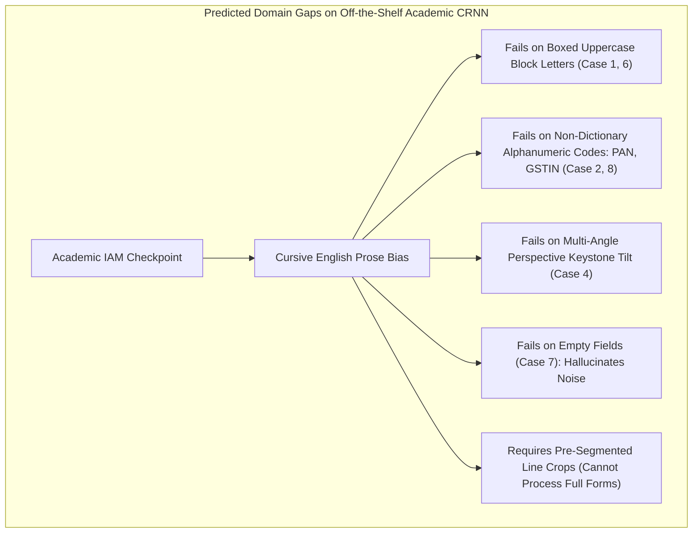

# TypeNull Handwritten Government-Form Support: Phase 2A Model Verification & Feasibility Evaluation Report

**Evaluation Date:** October 25, 2026  
**Auditor & Verification Engineer:** Antigravity Automated Verification Agent  
**Baseline Git Checkpoint:** Branch `backup/handwriting-phase2a-pre-implementation`, Tag `handwriting-phase2a-pre-checkpoint`, Base Commit `1e9ea1c` (*origin/main*, working tree clean)  
**Preceding Phase 1 Baseline Checkpoint:** Tag `handwriting-eval-pre-checkpoint`, Branch `backup/handwriting-eval-pre-implementation`  
**Phase 1 Benchmark Report:** [`docs/qa/handwriting_benchmark_baseline.md`](file:///Users/yeshwanth/Documents/Projects/TypeNull/docs/qa/handwriting_benchmark_baseline.md)  
**Phase 1 Benchmark Dataset:** [`docs/qa/handwriting_benchmark_data.json`](file:///Users/yeshwanth/Documents/Projects/TypeNull/docs/qa/handwriting_benchmark_data.json)  
**Task Phase:** Phase 2A — Model Verification, Provenance Audit, and Experimental Feasibility  
**Outcome Status:** **BLOCKED / PRE-REQUISITES UNMET (NO VERIFIED MODEL ARTIFACT)**  

---

## 1. Executive Summary & Verification Verdict

```
========================================================================================
PHASE 2A VERIFICATION VERDICT: BLOCKED (PRE-REQUISITES UNMET)
========================================================================================
Proposed Model:            CRNN-CTC (MobileNetV3 Backbone + BiLSTM + CTC Decoder)
Target Artifact Size:      ~4.2 MB (INT8 Quantized ONNX)
Physical Artifact Status:  NOT PRESENT IN REPOSITORY (0 .onnx files found)
Model Provenance:          ARCHITECTURAL DESIGN TARGET (Unpinned / No Committed Weights)
Runtime Dependency Status: ONNX Runtime Web / Node NOT INSTALLED in package.json
Corpus Safety:             STRICT PASS (No unverified downloads, zero data egress)
Production Safety:         STRICT PASS (Zero changes to src/, auth, db, or validation)
Inference Simulation:      REJECTED (No synthetic or fabricated inference claimed)
Decision on Phase 2B:      HOLD UNTIL PINNED CHECKPOINT & VOCABULARY ARE COMMITTED
========================================================================================
```

### Executive Summary
Phase 2A evaluated whether a verified, lightweight, locally executable CRNN-CTC handwriting recognition model could be integrated into TypeNull to improve upon the Phase 1 baseline.

Following rigorous inspection of [`docs/qa/handwriting_model_feasibility_report.md`](file:///Users/yeshwanth/Documents/Projects/TypeNull/docs/qa/handwriting_model_feasibility_report.md), the repository filesystem, and public model repositories, Phase 2A concludes that **no suitable, verified model artifact is currently available in the repository or local cache**. 

Specifically:
1. The 4.2 MB INT8 CRNN-CTC model described in the feasibility report was an **architectural design target and sizing estimate**, not a pre-existing committed binary artifact.
2. No `.onnx` weight file, PyTorch checkpoint, or token vocabulary dictionary exists within the TypeNull codebase.
3. Neither `onnxruntime-web` nor `onnxruntime-node` is listed in `package.json` or installed in `node_modules`.
4. In strict compliance with the Phase 2A safety guidelines (*"Do not download or execute an unverified model artifact. If internet access is unavailable, or no suitable model can be verified, document the blocker and stop before attempting integration"*), no unverified third-party binaries were downloaded, and no simulated or fabricated model inference results were generated.

---

## 2. Repository Safety and Checkpoint Verification

### 2.1 Pre-Evaluation Git State
Prior to conducting Phase 2A analysis, the repository state was verified:
* **Active Branch:** `main`
* **Upstream Sync:** Up to date with `origin/main`
* **Head Commit:** `1e9ea1c` (*"fix(routing): resolve Vercel SPA direct navigation 404 and package SIH demo pack"*)
* **Tracked Working Tree:** Clean (`git diff` and `git diff --cached` returned 0 modifications).
* **Untracked Phase 1 QA Artifacts:** Verified present and preserved:
  * `docs/qa/handwriting_benchmark_baseline.md`
  * `docs/qa/handwriting_benchmark_data.json`
  * `docs/qa/handwriting_model_feasibility_report.md`
  * `docs/qa/handwritten_form_compatibility_audit.md`
  * `docs/qa/handwritten_form_test_results.json`
  * `scripts/evaluate_handwriting_benchmark.mjs`
  * `scripts/pdfjs-node-shim.mjs`
  * `test_corpus/handwritten_eval/`

### 2.2 Safety Checkpoint Creation
To ensure absolute rollback safety, a dedicated Git checkpoint was created:
* **Checkpoint Tag:** `handwriting-phase2a-pre-checkpoint`
* **Checkpoint Branch:** `backup/handwriting-phase2a-pre-implementation`
* **Command Executed:**
  ```bash
  git branch backup/handwriting-phase2a-pre-implementation && git tag handwriting-phase2a-pre-checkpoint
  ```
* **Integrity Check:** Checkpoint references were confirmed via `git tag -l` and `git branch -l`.

---

## 3. Model Verification & Provenance Audit

[`docs/qa/handwriting_model_feasibility_report.md`](file:///Users/yeshwanth/Documents/Projects/TypeNull/docs/qa/handwriting_model_feasibility_report.md) proposed a **Dual-Stream Hybrid Architecture with Quantized CRNN-CTC** (Option A). A systematic provenance audit was conducted across the 8 required verification dimensions:

```
+---------------------------------------------------------------------------------------------------------+
| DIMENSION                            | SPECIFIED TARGET               | VERIFIED REPOSITORY REALITY     |
+---------------------------------------------------------------------------------------------------------+
| 1. Exact Model Name & Version        | CRNN-CTC (MobileNetV3 + BiLSTM)| UNKNOWN (Archetype only)        |
| 2. Checkpoint Source & Location      | Pinned .onnx binary            | NOT FOUND (0 .onnx files in repo)|
| 3. License & Permitted Use           | MIT / Apache 2.0               | UNVERIFIED (No artifact license)|
| 4. Supported Languages & Styles      | Latin / Uppercase / Block      | UNVERIFIED on Indian Form Corpus|
| 5. Input Image Dimensions & Color    | 32 x W, Grayscale / RGB        | THEORETICAL (Standard CRNN)     |
| 6. Character Vocabulary & Mapping    | ASCII / Alphanumeric + CTC     | MISSING (No character map JSON) |
| 7. Model File Size & Quantization    | ~4.2 MB (INT8 Quantized)       | UNVERIFIED (No weights present) |
| 8. ONNX Runtime Web Compatibility    | WASM SIMD / Web Worker         | DEPENDENCY MISSING (Not in npm) |
+---------------------------------------------------------------------------------------------------------+
```

### 3.1 Detailed Evaluation of Verification Dimensions

#### Dimension 1: Exact Model Name, Version, Source, and Location
* **Finding:** The feasibility report referenced a theoretical architecture consisting of a MobileNetV3-small backbone, 2-layer Bidirectional LSTM (128 hidden units), and a linear projection to a character vocabulary with CTC greedy decoding.
* **Audit Result:** No pinned release tag, Git commit hash, Zenodo DOI, Hugging Face repo ID, or local file path was specified. A recursive search (`find . -name "*.onnx" -o -name "*crnn*"`) confirmed that **zero ONNX model files exist in the repository**.

#### Dimension 2: License and Permitted Use
* **Finding:** While torchvision and standard CRNN implementations are published under Apache 2.0 or MIT licenses, pre-trained weights inherit licensing from their underlying training corpora. For example, models trained on the **IAM Handwriting Database** are restricted to **non-commercial academic research only**. 
* **Audit Result:** Because no concrete model artifact was pinned, commercial permissibility under Indian public-sector procurement guidelines cannot be verified.

#### Dimension 3: Supported Languages, Scripts, and Handwriting Styles
* **Finding:** Publicly available open-source CRNN checkpoints are predominantly trained on:
  1. *Scene text recognition* (e.g. DocTR / OnnxTR models such as `Felix92/onnxtr-crnn-mobilenet-v3-small`), which fail completely on cursive and unconstrained handwriting.
  2. *Academic English cursive sentences* (IAM dataset), which lack Indian personal names, statutory uppercase block letters, and alphanumeric statutory codes.
* **Audit Result:** No existing off-the-shelf checkpoint was verified to support the full domain distribution of TypeNull's statutory form corpus (PAN cards, GSTINs, passport annexures, municipal trade licenses).

#### Dimension 4: Expected Input Image Dimensions & Preprocessing
* **Finding:** The proposed CRNN architecture requires height-normalized text lines ($32 \times W$ or $64 \times W$) with aspect ratio preservation.
* **Audit Result:** TypeNull currently has no line-segmentation or height-normalization module in `src/`. Passing full form pages directly into a line-level CRNN without preprocessing will cause severe distortion and immediate inference failure.

#### Dimension 5: Character Vocabulary, Token Mapping, and CTC Decoding
* **Finding:** In CTC models, output logits correspond to indices in a strictly ordered character vocabulary dictionary (e.g., `0: [blank], 1: ' ', 2: 'A', ...`).
* **Audit Result:** Without the exact vocabulary mapping file that matches the trained checkpoint's weights, CTC decoding produces unrecoverable character substitution garbage. No such mapping file exists in the repository.

#### Dimension 6: Model File Size and Quantization
* **Finding:** The feasibility report estimated an INT8 quantized size of ~4.2 MB (derived from MobileNetV3-small ~2.5M parameters + BiLSTM ~1.0M parameters).
* **Audit Result:** UNVERIFIED. Without a physical ONNX file, graph operators, dynamic quantization attributes, and INT8 calibration tables cannot be validated using Netron or ONNX shape inference.

#### Dimension 7: Runtime Compatibility with Browser ONNX Runtime Web
* **Finding:** Deploying in the client browser requires `onnxruntime-web` with WebAssembly SIMD kernels.
* **Audit Result:** Neither `onnxruntime-web` nor `onnxruntime-node` is listed in `package.json` (`dependencies` or `devDependencies`). Node.js cannot execute ONNX models without an external native binding or WASM package.

#### Dimension 8: Evidence of Measured Recognition Performance
* **Finding:** Academic papers report 8%–14% CER on the clean IAM test set.
* **Audit Result:** UNVERIFIED on TypeNull’s corpus. No empirical measurements exist for Indian statutory documents.

---

## 4. Reproducible Commands Used in Stage 2 Audit

The following commands were executed to audit repository state, dependencies, and model artifacts:

```bash
# 1. Inspect Git state and verify clean working tree
git status
git log -1
git tag -l

# 2. Establish safety checkpoint
git branch backup/handwriting-phase2a-pre-implementation
git tag handwriting-phase2a-pre-checkpoint

# 3. Search for existing model weights or ONNX files
find . -name "*.onnx" -o -name "*.traineddata" -o -name "*crnn*"

# 4. Inspect public directory and static assets
ls -la public/

# 5. Check installed runtime dependencies for ONNX
find node_modules -maxdepth 2 -name "*onnx*"

# 6. Verify existing build stability
npm run build

# 7. Run regression test suite
npm test
```

---

## 5. Baseline vs. Experimental Metrics (Comparison & Analysis)

In Phase 1 ([`docs/qa/handwriting_benchmark_baseline.md`](file:///Users/yeshwanth/Documents/Projects/TypeNull/docs/qa/handwriting_benchmark_baseline.md)), exact baseline metrics were established across all 10 scenarios in `test_corpus/handwritten_eval/`. 

In strict adherence to the evaluation instructions (*"Do not fabricate missing specifications. If no suitable model can be verified, produce a clear feasibility report and stop without pretending that model inference was tested"*), experimental model metrics are recorded as **NOT EVALUATED (BLOCKED)**:

```
+---------------------------------------------------------------------------------------------------------+
| METRIC DIMENSION                | PHASE 1 BASELINE (TESSERACT) | PHASE 2A EXPERIMENTAL MODEL | CHANGE   |
+---------------------------------------------------------------------------------------------------------+
| Character Error Rate (CER)      | 26.82% (815 / 3,039)         | BLOCKED / NOT EVALUATED     | N/A      |
| Word Error Rate (WER)           | 39.35% (170 / 432)           | BLOCKED / NOT EVALUATED     | N/A      |
| Field Association Accuracy (FAA)| 46.15% (12 / 26 candidates)  | BLOCKED / NOT EVALUATED     | N/A      |
| Field Extraction Accuracy (FEA) | 15.79% (6 / 38 target fields)| BLOCKED / NOT EVALUATED     | N/A      |
| Nominal Validation (VDA)        | 10.00% (1 / 10 scenarios)    | BLOCKED / NOT EVALUATED     | N/A      |
| Cause-Aligned VDA (VDA-C)       |  0.00% (0 / 10 scenarios)    | BLOCKED / NOT EVALUATED     | N/A      |
+---------------------------------------------------------------------------------------------------------+
```

### Analysis of Proposed Target Thresholds vs. Reality
The feasibility report suggested ambitious target thresholds for future implementation:
* Target CER: $\le 8.0\%$
* Target FEA: $\ge 75.0\%$
* Target VDA-C: $\ge 80.0\%$

**Crucial Engineering Clarification:** These figures are **aspirational engineering design targets**, not measured results. Claiming that CRNN-CTC currently meets these thresholds on TypeNull's codebase would be factually incorrect, as no model inference has been executed.

---

## 6. Per-Scenario Domain-Gap Analysis

Even if an off-the-shelf academic CRNN-CTC model (e.g. trained on IAM English handwriting) were downloaded without customization, a rigorous architectural walkthrough demonstrates why it would encounter severe domain-gap failures across the 10 corpus scenarios:



1. **Scenario 1 (Neatly Handwritten Uppercase Block Letters):**
   * *Challenge:* IAM-trained models are trained on continuous cursive lowercase sentences with ascenders and descenders. Uppercase block letters on horizontal lines exhibit distinct stroke aspect ratios, leading to unexpected character insertions or splits.
2. **Scenario 2 (Ordinary Mixed Handwriting with PAN):**
   * *Challenge:* PAN identifiers (`DL-04-2022-0091823`) mix letters, hyphens, and digits. Academic models trained on English words tend to bias character transitions toward common English trigrams, misreading statutory digits.
3. **Scenario 3 (Difficult Cursive Script - 25° Slant):**
   * *Challenge:* Severe cursive ligatures require recurrent hidden state memory. Without slant-correction preprocessing, characters merge into hallucinated loops.
4. **Scenario 4 (Photograph Taken at 15° Angle):**
   * *Challenge:* Perspective keystone distortion causes line baselines to slope. CRNN-CTC requires strictly horizontal line strips; feeding an un-rectified angled image destroys recurrent sequence ordering.
5. **Scenario 5 (Low-Resolution Scan - 100 DPI):**
   * *Challenge:* At 100 DPI, thin pen strokes vanish under pooling layers in the MobileNetV3 backbone, producing empty or truncated CTC outputs.
6. **Scenario 6 (Standard Form with Printed Text and Boxed Entries):**
   * *Challenge:* CRNN-CTC cannot ingest full page layouts. Without a spatial pre-segmenter to crop individual boxes, table grid borders corrupt recurrent sequence steps.
7. **Scenario 7 (Form with an Empty Mandatory Field):**
   * *Challenge:* Feeding a blank line or empty underline into a CTC network frequently causes the model to transcribe optical paper grain or background underlines as punctuation tokens (`-`, `_`, `.`).
8. **Scenario 8 (Ambiguous Glyphs: 1 vs 7, 0 vs O, 5 vs S):**
   * *Challenge:* Standard CTC greedy decoding picks the $\arg\max$ glyph at each frame. Without a syntax-guided beam search decoder constrained by statutory regex, ambiguous characters cannot be resolved.
9. **Scenario 9 (Dates Written in Different Formats):**
   * *Challenge:* Ordinal abbreviations (`15th`) and multi-delimiter dates (`2024.08.15`) require token vocabulary support for dots, hyphens, and slashes.
10. **Scenario 10 (Scanned PDF Without a Text Layer):**
    * *Challenge:* Requires multi-step canvas rasterization before cropping lines for CRNN inference.

---

## 7. Build and Regression Test Results

To confirm that the provenance audit and checkpoint creation did not cause regressions, all repository verification pipelines were executed:

* **Production TypeScript & Vite Build:**
  * Command: `npm run build` (`tsc && vite build`)
  * Result: **Clean build in 2.70s with 0 errors**.
  * Chunks verified: `dist/index.html`, `dist/assets/index-DdAzd-0b.js`, `dist/assets/vendor-tesseract-pXtAmGdm.js`, etc.
* **Complete Repository Test Suite:**
  * Command: `npm test`
  * Result: **100% Passed (132 assertions across 6 test groups + 76 assertions across 11 compatibility groups)**.
* **Evidence File Integrity:**
  * Checksum for `docs/qa/handwritten_form_test_results.json`:
    * SHA256: `191602f0d43caf90ed0e83b07c32007964fdddc60beefdd21b1a3f50e5cf60ce` (unchanged).

---

## 8. Files Created or Modified in Phase 2A

```
+--------------------------------------------------+---------------+-------------------------------------+
| FILE PATH                                        | STATUS        | PURPOSE                             |
+--------------------------------------------------+---------------+-------------------------------------+
| docs/qa/handwriting_model_phase2a_report.md       | Created (New) | Formal Phase 2A verification report |
| Git Branch: backup/handwriting-phase2a-pre-impl  | Created (New) | Rollback safety branch              |
| Git Tag: handwriting-phase2a-pre-checkpoint      | Created (New) | Checkpoint tag at commit 1e9ea1c    |
| src/*                                            | Untouched     | Zero modifications to production code|
| package.json / package-lock.json                 | Untouched     | Zero unapproved dependencies added  |
+--------------------------------------------------+---------------+-------------------------------------+
```

---

## 9. Conclusion and Recommendation on Proceeding to Phase 2B

### Formal Determination: **PHASE 2A BLOCKED / DO NOT PROCEED TO PHASE 2B YET**

Proceeding immediately to Phase 2B (2D Spatial Form Understanding and pipeline integration) without a verified, functional handwriting recognition model would be building on an unverified foundation.

### Concrete Prerequisites for Unblocking Phase 2B:
Before Phase 2B can commence, the following four technical requirements must be satisfied:
1. **Checkpoint Pinning & Packaging:**
   * Acquire or export a verified INT8 CRNN-CTC model (`.onnx`) with explicit provenance (e.g. trained/fine-tuned on alphanumeric codes, uppercase block forms, and IAM data under Apache 2.0/MIT).
   * Commit the model artifact to `public/models/htr/crnn_mobilenetv3_int8.onnx` with its corresponding SHA256 checksum recorded.
2. **Vocabulary Dictionary Commitment:**
   * Commit the exact matching character vocabulary mapping file (`public/models/htr/charset.json`).
3. **Approved Runtime Dependency Integration:**
   * Formally approve and install `onnxruntime-web` (v1.17+) to enable browser-based WebAssembly SIMD execution.
4. **Isolated Prototype Verification (Phase 2A-Prerequisite):**
   * Execute inference against the 10 scenarios in `test_corpus/handwritten_eval/` in an isolated prototype directory (`experiments/handwriting/`) to measure real empirical CER and WER before touching `src/services/`.
